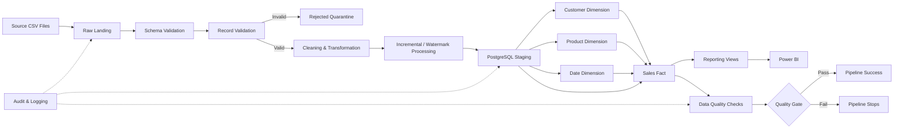

# Enterprise Data Pipeline & ETL Automation System

A production-style end-to-end data engineering project built from scratch using Python, PostgreSQL, SQLAlchemy, Docker, automated testing, CI/CD, incremental processing, auditing, and warehouse data-quality controls.

The project demonstrates how a modern batch ETL platform can ingest raw source data, validate and quarantine bad records, transform business data, load a dimensional warehouse, enforce data-quality gates, and run reproducibly through Docker.

---

## Project Overview

The pipeline processes four business datasets:

- Customers
- Products
- Orders
- Order Items

The data moves through a layered architecture:

```text
Source CSV Files
        ↓
Raw Landing
        ↓
Schema Validation
        ↓
Record-Level Validation
        ↓
Rejected Record Quarantine
        ↓
Data Cleaning
        ↓
Transformation
        ↓
Incremental Processing
        ↓
PostgreSQL Staging
        ↓
Warehouse Dimensions
        ↓
Sales Fact
        ↓
Reporting Views
        ↓
Data Quality Gate
```

The complete workflow can be executed locally or entirely through Docker Compose.

---

## Dashboard Preview

The project includes a Power BI reporting layer connected directly to the curated PostgreSQL reporting schema.

### Executive Sales Overview

Provides a business-facing view of sales performance, including:

- Total sales
- Completed sales
- Total orders
- Total units sold
- Daily sales trend
- Product-level sales performance
- Customer-level sales performance


### Pipeline Health & Data Quality

Provides an operational data-engineering view of ETL execution and data quality, including:

- Total pipeline runs
- Successful and failed runs
- Pipeline success rate
- Records processed by pipeline
- Execution status and batch information
- Valid, rejected, and excluded record counts


The Power BI report file is available at:

`dashboards/Enterprise_Data_Pipeline_Dashboard.pbix`

## System Architecture



## Key Features

### Source Ingestion

CSV source files are ingested into a raw landing layer before downstream processing.

The raw copy preserves the source data associated with each pipeline batch for traceability and debugging.

---

### Schema Validation

Incoming datasets are checked for required columns before record processing begins.

A structurally invalid source file cannot continue through the pipeline.

---

### Record-Level Validation

Individual records are validated for business and technical correctness.

Examples include:

- Required identifiers
- Positive numeric IDs
- Whole-number identifiers
- Valid dates
- Valid timestamps
- Allowed order statuses
- Positive quantities
- Valid product prices

Invalid records are separated from valid records.

---

## Rejected Record Quarantine

Records that fail validation are written to a rejected-data area rather than silently discarded.

```text
data/rejected/
```

This makes failed records available for:

- Troubleshooting
- Data correction
- Auditing
- Source-system investigation

---

## Data Cleaning

Validated records are standardized before loading.

Examples include:

- Numeric type conversion
- Date conversion
- UTC timestamp normalization
- Text trimming
- Order-status normalization
- Identifier normalization

---

## Incremental Order Processing

The Order pipeline supports true incremental processing using:

```text
source_updated_at
```

A PostgreSQL watermark stores the latest successfully processed source timestamp.

Example:

```text
Saved watermark
2026-10-18 10:20 UTC

Incoming records

10:15 → ignored
10:20 → ignored
10:25 → processed
```

Only records where:

```text
source_updated_at > saved watermark
```

continue through the pipeline.

The watermark is advanced only after successful processing.

This prevents data loss if a pipeline execution fails.

---

## File-Level Idempotency

The pipeline also calculates a SHA-256 fingerprint for source files.

Previously processed source versions can therefore be detected and skipped.

This prevents accidental duplicate processing of identical files.

---

## PostgreSQL Staging Layer

Validated and transformed records are loaded into PostgreSQL staging tables.

Examples include:

```text
staging.stg_customers
staging.stg_products
staging.stg_orders
staging.stg_order_items
```

Staging preserves batch metadata including:

- Batch ID
- Source name
- Processed timestamp
- Loaded timestamp

---

## Dimensional Data Warehouse

The project implements a dimensional warehouse architecture.

### Dimensions

```text
warehouse.dim_customer
warehouse.dim_product
warehouse.dim_date
```

### Fact Table

```text
warehouse.fact_sales
```

The grain of the sales fact is:

```text
One row per Order Item
```

The fact table connects business transactions with customer, product, and date dimensions.

---

## Date Dimension

The date dimension is automatically populated for:

```text
2020 → 2035
```

When PostgreSQL is initialized through Docker, the date dimension population script is automatically executed after the warehouse DDL.

This makes the Docker environment fully reproducible.

---

## Sales Fact Loading

Sales facts are created using the most recent staged business records.

The loader supports repeatable execution and avoids duplicate fact rows using the Order Item business key.

---

## Reporting Layer

The project includes reporting views such as:

```text
Daily Sales Summary
Product Sales Summary
Customer Sales Summary
Pipeline Health Summary
```

These views provide a clean semantic layer that can be consumed by BI tools such as Power BI.

---

## Data Quality Framework

The warehouse runs automated data-quality checks before the full pipeline is considered successful.

Current checks include:

1. Orders reference valid customers
2. Order Items reference valid products
3. Order Items reference valid orders
4. Orders reference valid dates
5. Duplicate Orders within a source batch
6. Duplicate Order Items within a source batch
7. Sales fact record count reconciles with staging
8. Sales fact monetary total reconciles with staging

The pipeline uses a fail-fast quality gate.

Example successful execution:

```text
Total checks: 8
Passed: 8
Failed: 0

DATA QUALITY GATE: PASSED
```

If a critical check fails, the pipeline stops.

---

## Pipeline Auditing

Every pipeline execution is tracked in PostgreSQL.

Audit information includes:

- Run ID
- Batch ID
- Pipeline name
- Source name
- Execution status
- Total records
- Valid records
- Rejected records
- Start time
- Completion time
- Failure information

This provides operational traceability for pipeline executions.

---

## Logging & Observability

The project uses centralized Python logging.

Logs are written to:

```text
logs/enterprise_etl.log
```

The logging implementation supports:

- Console logs
- File logs
- Rotating log files
- Batch identifiers
- Pipeline execution context
- Error tracebacks

---

## Full Pipeline Orchestration

The complete workflow is controlled by:

```text
scripts/run_full_pipeline.py
```

The orchestrator executes:

```text
1. Customer Pipeline
2. Product Pipeline
3. Order Pipeline
4. Order Item Pipeline
5. Sales Fact Load
6. Warehouse Data Quality Checks
```

The workflow follows a fail-fast strategy.

If any child pipeline fails, the complete workflow stops.

---

## Automated Testing

The project contains both unit and integration tests using:

```text
pytest
```

Tests cover areas such as:

- Schema validation
- Record validation
- Cleaning
- Transformation
- Staging loaders
- Dimension loaders
- Fact loaders
- Incremental filtering
- Watermark tracking
- Processed-source tracking
- Data-quality checks
- Full incremental Order scenarios

Run the complete test suite with:

```bash
python -m pytest -v
```

---

## CI/CD

GitHub Actions automatically validates the project whenever code is pushed to `main` or submitted through a pull request.

The CI workflow performs:

```text
Repository checkout
        ↓
Python environment setup
        ↓
Project installation
        ↓
Critical code-quality checks
        ↓
pytest
```

This ensures broken code is detected before further deployment.

---

## Docker

The entire application can run in containers.

The Docker environment contains:

```text
ETL Container
      ↓
Docker Network
      ↓
PostgreSQL Container
```

The ETL application communicates with PostgreSQL using the internal Docker hostname:

```text
postgres
```

rather than `localhost`.

---

## Running with Docker

### Build and Start PostgreSQL

```bash
docker compose up -d postgres
```

Check status:

```bash
docker compose ps
```

---

### Test ETL Database Connectivity

```bash
docker compose run --rm etl python -c "from enterprise_etl.database.connection import DatabaseConfig, create_database_engine, test_database_connection; config = DatabaseConfig.from_environment(); engine = create_database_engine(config); test_database_connection(engine); print('Docker ETL successfully connected to PostgreSQL'); engine.dispose()"
```

Expected result:

```text
Docker ETL successfully connected to PostgreSQL
```

---

### Run the Complete Pipeline

```bash
docker compose run --rm etl
```

Successful execution ends with:

```text
DATA QUALITY GATE: PASSED

Full enterprise ETL pipeline completed successfully.
Completed steps: 6/6
```

---

## Docker Database Access

The containerized PostgreSQL instance is exposed to Windows on:

```text
localhost:5433
```

Inside Docker, applications connect using:

```text
postgres:5432
```

---

## Project Structure

```text
enterprise-data-pipeline/
│
├── .github/
│   └── workflows/
│       └── ci.yml
│
├── config/
│
├── data/
│   ├── incoming/
│   ├── raw/
│   └── rejected/
│
├── dashboards/
│
├── logs/
│
├── scripts/
│   ├── run_customer_pipeline.py
│   ├── run_product_pipeline.py
│   ├── run_order_pipeline.py
│   ├── run_order_item_pipeline.py
│   ├── run_sales_fact_load.py
│   ├── run_data_quality_checks.py
│   └── run_full_pipeline.py
│
├── sql/
│   ├── ddl/
│   ├── reporting/
│   └── warehouse/
│
├── src/
│   └── enterprise_etl/
│       ├── cleaning/
│       ├── database/
│       ├── ingestion/
│       ├── observability/
│       ├── orchestration/
│       ├── transformation/
│       └── validation/
│
├── tests/
│   ├── integration/
│   └── unit/
│
├── .dockerignore
├── .env.example
├── .gitignore
├── compose.yml
├── Dockerfile
├── pyproject.toml
└── README.md
```

---

## Technology Stack

### Programming

- Python
- SQL

### Data Processing

- pandas
- SQLAlchemy

### Database

- PostgreSQL

### Data Modeling

- Dimensional Modeling
- Fact and Dimension Tables

### Testing

- pytest

### DevOps

- Git
- GitHub
- GitHub Actions
- Docker
- Docker Compose

### Data Quality

- Custom Python/SQL validation framework
- Warehouse reconciliation
- Fail-fast quality gates

---

## Engineering Concepts Demonstrated

This project demonstrates practical experience with:

- ETL architecture
- Batch processing
- Incremental loading
- Watermark processing
- Idempotency
- Data validation
- Data quarantine
- Data cleaning
- Dimensional modeling
- Data warehousing
- Fact/dimension loading
- Pipeline auditing
- Data-quality engineering
- Reconciliation
- Logging
- Error handling
- Automated testing
- CI/CD
- Docker
- PostgreSQL
- Reproducible environments

---

## Current Status

### Completed

- Source ingestion
- Validation framework
- Rejected-record handling
- Cleaning and transformation
- PostgreSQL staging
- Customer dimension
- Product dimension
- Date dimension
- Sales fact
- Reporting SQL views
- Incremental Order processing
- Watermark management
- Source idempotency
- Pipeline auditing
- Logging
- Data-quality framework
- Quality gate
- Unit tests
- Integration tests
- Full pipeline orchestration
- GitHub Actions CI
- Dockerized ETL application
- Dockerized PostgreSQL
- Full Docker Compose ETL execution

### Next

- Power BI dashboard
- Architecture visual documentation
- Final portfolio screenshots
- Resume-ready project summary
- Final repository cleanup and release

---

## Project Goal

The purpose of this project is not simply to build an ETL script.

The objective is to demonstrate how a complete data-engineering system can be designed with production-oriented concepts such as:

```text
Reliability
Reproducibility
Auditability
Data Quality
Testing
Observability
Incremental Processing
Deployment
```

The project was built incrementally from the architecture level upward so that every major component can be understood, tested, and explained independently.